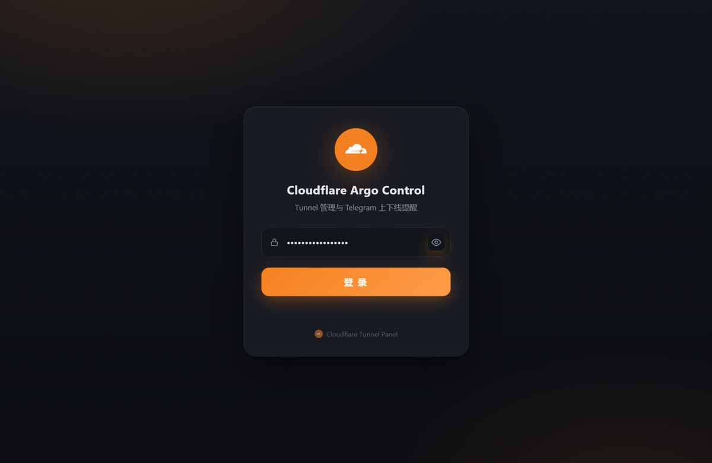
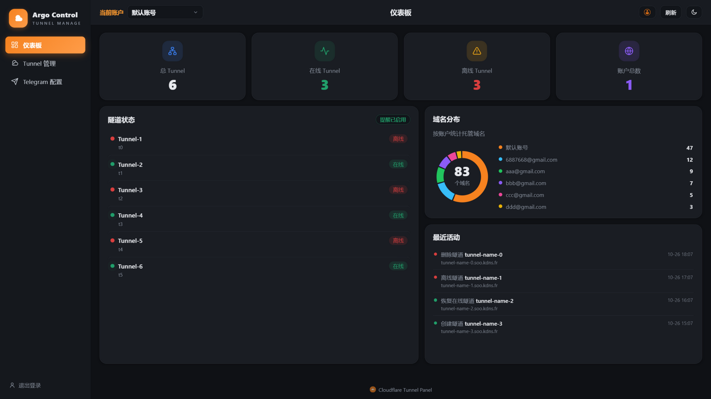
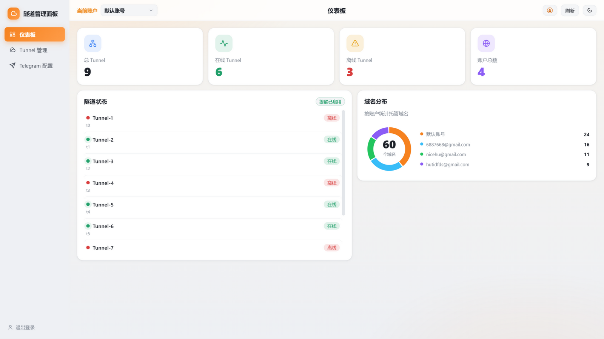

<div align="center">

# ⛅ Cloudflare Tunnel Pannel

**Cloudflare Tunnel 多账号可视化管理面板**

*单文件 Worker · 无需构建 · 无外部依赖*

[](https://workers.cloudflare.com)
[](#)
[](#-存储选择d1推荐或-kv)
[](#-telegram-提醒配置)
[](#)

**[English](./README.en.md)** | **简体中文**

</div>

---

## 🖼️ 界面预览

<div align="center">
  
  
  
</div>

## ✨ 功能特性

| | |
| --- | --- |
| 🔐 **密码登录** | 会话 Cookie 签名有效期 7 天，登录接口有防爆破延时，密码框支持显隐切换 |
| 👥 **多账号管理** | 顶栏下拉切换 Cloudflare 账号；添加账号先验证再保存（Token 只存 D1/KV），列表/路由/提醒按账号隔离 |
| 🖥️ **隧道管理** | 状态徽章（在线/降级/离线 + 运行时长）、搜索过滤、查看启动 Token、编辑（多路由可选中要改的那条）、删除 |
| ➕ **新建隧道** | 选域名 + 子域名 + 可选路径 + 本地服务地址，自动创建隧道并配置 DNS CNAME |
| 🌐 **多路由管理** | 单条隧道最多 60 条"域名 + 路径 → 服务"规则，自动处理 DNS，冲突时拒绝写入 |
| 📣 **Telegram 提醒** | 状态**变化**才推送、按隧道逐个开关（默认关）、多接收者、暂停/恢复、测试发送 |
| 🍩 **仪表板** | 总/在线/离线/账户数统计卡 + 域名分布环形图 + 最近活动 |
| 🌗 **亮暗主题** | 跟随系统 + 手动切换，选择本地记忆 |
| 📱 **PWA + 响应式** | 可安装到主屏，手机/平板/桌面自适应 |

> 整个项目只有 **一个文件**：`_worker.js`（Worker 代码 + 内嵌管理页面）。

## 🚀 快速部署

### 方式一：Cloudflare Dashboard（推荐新手）

1. 登录 [Cloudflare Dashboard](https://dash.cloudflare.com) → **Workers & Pages** → **Create**，创建 Worker 并把 `_worker.js` 内容全部粘贴进去，保存。
2. **【必须】绑定存储**：Settings → Bindings → 添加 **D1 Database**（变量名 `TUNNEL_DB`，建表见[下文](#-存储选择d1推荐或-kv)）或 **KV Namespace**（变量名 `TUNNEL_STATE`）。
3. **【必须】配置环境变量**：Settings → Variables and Secrets，添加 `CF_API_TOKEN`、`CF_ACCOUNT_ID`、`PASSWORD`（详见[环境变量](#️-环境变量)）。
4. 打开 `https://<Worker 域名>/`，输入密码登录即可。

### 方式二：wrangler CLI

```bash
wrangler d1 create tunnel-state   # 记下 database_id
wrangler d1 execute tunnel-state --remote \
  --command "CREATE TABLE IF NOT EXISTS state (k TEXT PRIMARY KEY, v TEXT NOT NULL)"
```

`wrangler.toml`：

```toml
name = "cf-tunnel-manage"
main = "_worker.js"
compatibility_date = "2024-09-23"

[[d1_databases]]
binding = "TUNNEL_DB"
database_name = "tunnel-state"
database_id = "<上一步返回的 id>"

[triggers]
crons = ["*/5 * * * *"]   # 可选: 每 5 分钟后台检查一次并提醒
```

```bash
wrangler secret put CF_API_TOKEN
wrangler secret put CF_ACCOUNT_ID
wrangler secret put PASSWORD
wrangler deploy
```

### 方式三：代码内配置填写区

不想用 Secrets？直接把值填进 `_worker.js` **顶部"配置填写区"**（`CONFIG_DEFAULTS`），留空的变量仍会读取 Dashboard 配置。

## ⚙️ 环境变量

| 变量 | 必填 | 说明 |
| --- | --- | --- |
| `CF_API_TOKEN` | ✅ | API 令牌，权限见[「API Token 权限配置」](#-api-token-权限配置) |
| `CF_ACCOUNT_ID` | ✅ | Cloudflare 账户 ID（Workers 页面右侧可见） |
| `PASSWORD` | ✅ | 面板登录密码，至少 6 位 |
| `SESSION_SECRET` | 建议 | 会话签名密钥，一串随机字符。不设置时由密码派生（改密码会使所有人重新登录） |
| `TUNNEL_DB` | ✅* | **D1 数据库绑定**（推荐）。与 `TUNNEL_STATE` 同时绑定时 D1 优先 |
| `TUNNEL_STATE` | 可选 | **KV 命名空间绑定**。未绑 D1 时的存储方式，二者至少绑一个（*存储也可在面板"配置填写区"之外的所有功能正常工作，仅提醒/账号等持久化需要） |
| `DEFAULT_SERVICE` | 可选 | 新建/编辑隧道时的默认本地服务地址，如 `http://localhost:8080` |
| `TG_BOT_TOKEN` | 可选 | Telegram 机器人 Token（环境变量兜底；也可在面板里保存） |
| `TG_CHAT_ID` | 可选 | 默认接收者 chat_id（环境变量兜底） |

## 🔑 API Token 权限配置

创建 API Token（My Profile → API Tokens → Create Token → Custom token）时，按下面两组勾选。注意区分**账户级（整个账户）**和**区域级（所有域名 / Zone Resources 选 All zones）**两组，名字相近但作用完全不同：

**账户级（Account Resources 选整个账户）：**

| 分组 | 权限项 | 级别 |
| --- | --- | --- |
| DNS & Zones | Account DNS Settings | Read + Edit |
| DNS & Zones | DNS View | Read + Edit |
| Cloudflare Tunnel（或 Argo Tunnel） | Cloudflare Tunnel | Read + Edit |

**区域级（Zone Resources 选"所有域名 / All zones"）：**

| 分组 | 权限项 | 级别 |
| --- | --- | --- |
| DNS & Zones | DNS | Read + Edit |
| DNS & Zones | Zone | Read + Edit |
| DNS & Zones | Zone DNS Settings | Read + Edit |
| DNS & Zones | Zone Settings | Read + Edit |

> 💡 最小可用集只需：账户级 `Cloudflare Tunnel → Edit` + 区域级 `DNS → Read/Edit`、`Zone → Read`；多勾的项是无害冗余。常见错误是只配了账户级的 Account DNS Settings / DNS View（管的是账户 DNS 全局设置，不是 Zone 里的 DNS 记录），会导致"该域名已存在 DNS 记录"或删除隧道后 DNS 清理失败——**区域级的 `DNS → Edit` 必须有**。

## 💾 存储选择：D1（推荐）或 KV

KV 有每日写入次数限制且存在最终一致延迟（写后立刻读可能读到旧值），本面板读写频繁，推荐使用 D1：

1. Dashboard → Storage & Databases → D1 → Create，建一个数据库，名称随意（例如 **`tunnel-state`**）；
2. 进入数据库控制台执行：

   ```sql
   CREATE TABLE IF NOT EXISTS state (k TEXT PRIMARY KEY, v TEXT NOT NULL);
   ```

3. Worker → Settings → Bindings → D1 Database，变量名填 **`TUNNEL_DB`**；
4. 重新部署。未绑定 D1 时自动回退到 KV（`TUNNEL_STATE`），行为不变；两者同时绑定则 D1 优先。

> 📦 D1 与 KV 存储相同的键值结构（`meta:settings`、`tunnel:state:<账号>:<隧道>`、`chat:*`）。从 KV 迁移到 D1 后，在面板里重新保存一次 Telegram 配置、重开一次提醒开关即可。

## 👥 多账号管理

- 环境变量 `CF_API_TOKEN` + `CF_ACCOUNT_ID` 配置的账号永远存在，名为"默认账号"，不可删除。
- 顶栏下拉切换账号，隧道列表、域名、路由、提醒开关随账号切换；选择记忆在 D1/KV，下次打开保持。
- 点击顶栏 **账号管理**：可添加（填名称、账户 ID、API Token，**先验证再保存**，Token 不回显）、编辑、删除账号。
- 提醒状态（上下线记录、20 秒防抖窗口）按账号隔离，互不串扰；Cron 定时检查会遍历**所有**账号。
- 未绑定存储时回退为环境变量单账号，其余功能不受影响。

## 📣 Telegram 提醒配置

1. 在 Telegram 找 [@BotFather](https://t.me/BotFather)，`/newbot` 创建机器人，拿到 **Bot Token**。
2. **想让谁收提醒，就让谁先给机器人发一条消息（或 `/start`）**——机器人无法主动私聊从未互动过的用户。
3. 获取接收者的 chat_id：
   - **个人私聊**：给 [@userinfobot](https://t.me/userinfobot) 发任意消息，它会回复你的**正数**数字 ID；
   - **群组**：把机器人拉进群，群的 ID 为负数（超级群组通常 `-100` 开头）；
   - **公开频道/群组**：直接填 `@用户名` 也可以，面板会解析成真实 chat_id 存入存储。
4. 打开面板 → **Telegram 配置**：填入 chat_id（接收者，**不是机器人的 ID**）和 Bot Token，点"**测试发送**"确认可达，再点"**保存推送配置**"。
5. 回到 **Tunnel 管理**，把需要监控的隧道从"🔕 提醒关"点成"🔔 提醒开"。

> ⚠️ 常见误区：chat_id 是"谁来**接收**消息"（你的用户 ID / 群 ID），Bot Token 才是机器人的。填机器人自己的 ID 会提示"机器人不能给自己发消息"。

### 提醒机制

- **默认关闭**：每条隧道需手动开启，开启状态保存在 D1/KV。
- 只在状态**变化**时发送一次（上线一次、离线一次），同一状态不重复提醒；首次记录到状态时不发送，部署后不会刷屏。
- 检查时机：每次打开/刷新面板时检查一次，连续刷新最少间隔 20 秒（防止把网络抖动看成多次上下线）。
- **无人值守检查**：给 Worker 添加 Cron 触发器（如 `*/5 * * * *`），`scheduled` 处理会自动遍历所有账号执行同样的检查。
- **暂停推送**：面板可暂停（限时或无限期），期间状态照常记录，只是不发消息。

## 📡 API 接口概览

除 `/api/login` 外，所有接口需登录（Cookie 会话）。均为 `POST` + JSON：

| 路径 | 说明 |
| --- | --- |
| `/api/login` `/api/logout` | 登录 / 退出 |
| `/api/init` | 域名 (Zone) 列表、默认服务地址、域名分布 |
| `/api/list` | 隧道列表 + 在线状态 + 运行时长 + 提醒状态（同时触发一次检查） |
| `/api/create` `/api/update` `/api/delete` | 新建 / 编辑 / 删除隧道 |
| `/api/token` | 获取隧道启动 Token（cloudflared 用） |
| `/api/uptime` | 连接器运行时长（官方后台"运行时间"同源） |
| `/api/detail` `/api/route` | 查看 / 增删隧道 ingress 路由 |
| `/api/alert` | 隧道提醒开关 (toggle) / 吞掉一次变化 (skip) |
| `/api/tg` | Telegram 配置：保存、测试、增删接收者、暂停/恢复 |
| `/api/acc` | 多账号：列表 (list) / 添加 (add，先验证) / 编辑 (edit) / 删除 (del) / 切换 (switch) |

## ❓ 常见问题

- **"未绑定 KV 命名空间 TUNNEL_STATE"**：绑定 D1（`TUNNEL_DB`）或 KV（`TUNNEL_STATE`），见[存储选择](#-存储选择d1推荐或-kv)。
- **"找不到该 chat_id"**：私聊接收者没给机器人发过 `/start`；或把机器人 ID/正数当成了群 ID。个人填正数用户 ID，群组填负数 ID。
- **"机器人 Token 无效"**：检查 Bot Token 是否复制完整、机器人是否被 BotFather 停用。
- **"隧道仍有活跃连接，请先停止 cloudflared"**：删除前先在目标机器上停止 `cloudflared` 进程（Cloudflare 平台限制）。
- **"该域名已存在其他 DNS 记录"**：先到 Zone 的 DNS 页面删除冲突记录，或换个子域名。
- **"DNS 记录清理失败"（删除隧道/路由后提示）**：检查 API Token 是否有**区域级 Zone → DNS → Edit** 权限（见[权限配置](#-api-token-权限配置)），账户级的 Account DNS Settings 不能替代它；toast 里会显示具体原因。
- **改密码后所有人掉线**：未设置 `SESSION_SECRET` 时会话密钥由密码派生；设置独立的 `SESSION_SECRET` 可避免。
- **旧版本"默认开提醒"想全部关**：新版已改为默认关并带一次性迁移，打开面板后旧数据自动清成关闭状态。

## 🔒 安全说明

- 所有 Cloudflare API 调用都在 Worker 服务端完成，Token 不会下发到浏览器。
- 隧道启动 Token（可冒充隧道接管流量）仅在登录后按需单独获取。
- 登录密码比较使用固定时间算法，防止时序侧信道；连续失败有延时惩罚。
- 建议同时设置 `SESSION_SECRET`，并给 Worker 域名加上 Cloudflare Access 作为第二层防护（可选）。

---

<div align="center">

**Argo Control** · Cloudflare Tunnel Manager

💝 赞助商: [ForZTN](https://sponsorship.forztn.com/github.com/eooce/Cloudflare-Tunnel-Panel)

</div>
